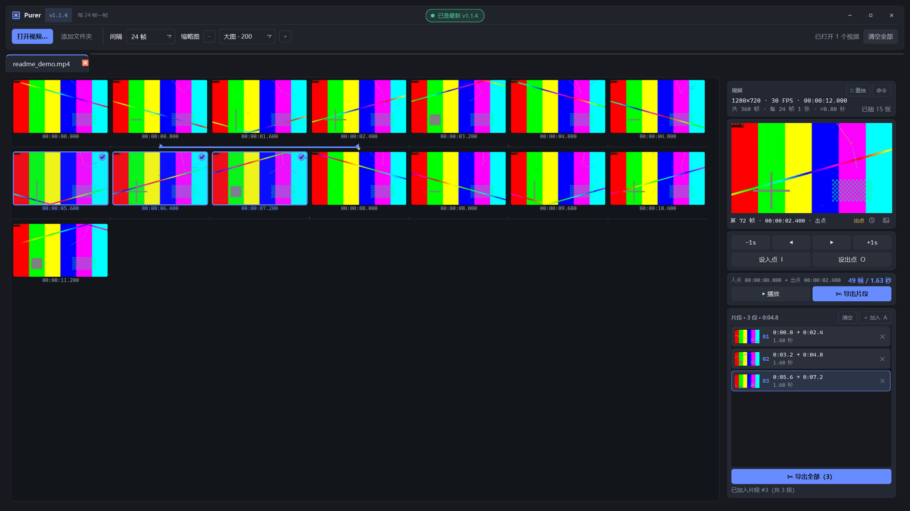
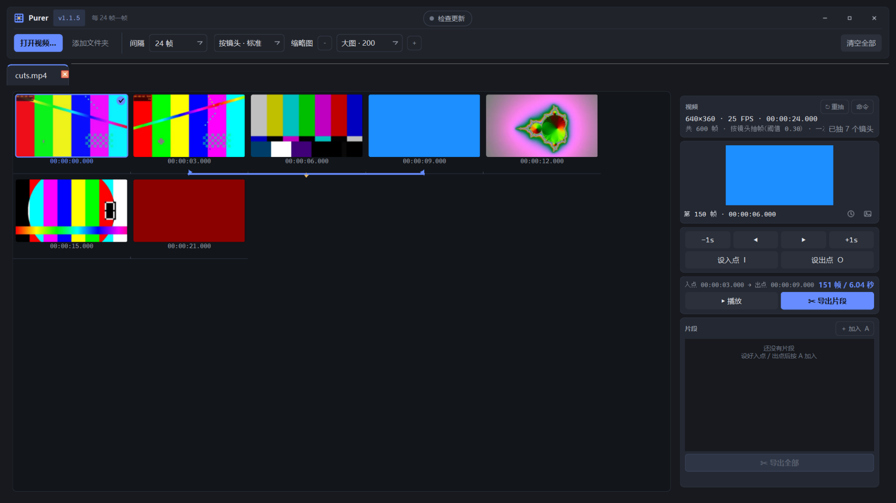
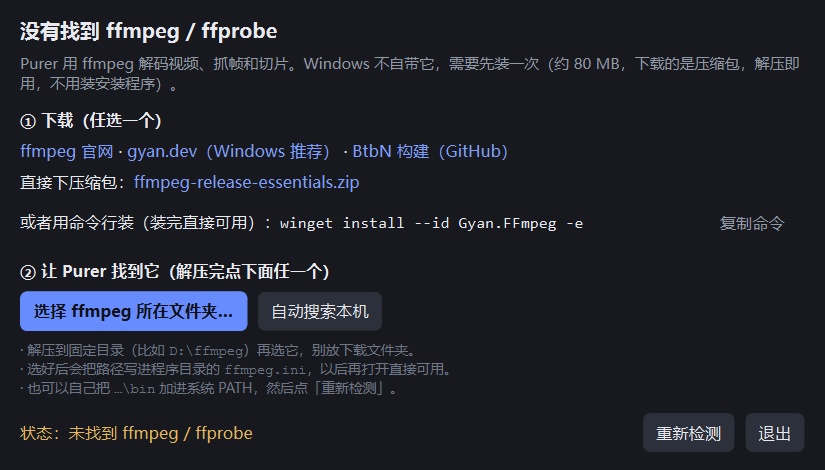

# Purer

**把视频铺成缩略图墙，翻素材、标入点出点、帧精确切片段。**



Purer 是一个 Windows 上的视频抽帧浏览 / 切片小工具（单文件 exe，免安装）。
拖进视频 → 每 N 帧取一张铺成图墙（**图墙本身就是时间轴**）→ 逐帧微调 →
设入点 / 出点 → **帧精确切片**（只重编码切点那 0.5–3 秒，中段保持原始码流）；
可以攒好几段，一次全部导出。

## 特点

- **图墙即时间轴**：缩略图下面那条线就是时间轴，刻度朝上；入点/出点画成一条蓝带，
  两端各有一个可以拖的小旗；当前帧是黄色小三角，精确到帧。
  小旗**横竖都能拖**：左右微调帧号，上下可以跳到别的行（自动吸附到离鼠标最近的那条时间轴，
  一次跳很远）；拖动过程中右侧预览和黄色三角都实时跟着**正在拖的那一帧**，
  不是停在原来的入点/光标上（拖的时候先出墙上的缩略图，停手 0.14 秒再补一张精确帧，所以不卡）。
- **帧精确切片**：调用 ffmpeg 只重编码「起点 → 下一个关键帧」这一小段再拼接，
  切出来的第一帧就是你点的那一帧，其余 99% 仍是无损原始码流。
  拼接后自动校验，不通过就**自动退回无损**并说明原因（不会给你一个坏文件）。
- **多段批量**：设好一段按 `A` 加入片段列表，一次导出 `_seg01_…`、`_seg02_…`，
  某一段失败不影响其它段。
- **低配不卡**：抽帧 / 导出共用一个队列（同一时刻只跑 1 个 ffmpeg，且只占一半 CPU 线程）；
  显示尺寸和抽取尺寸分离 —— 改缩放**不重抽**、不新增任务。
- **抽帧间隔可预设可手输**：`1 / 2 / 4 / 6 / 8 / 12 / 24 / 30 / 48 / 96 帧`，
  另有 `23.98 / 29.97 / 59.94 帧` 这种「常见帧率下约 1 秒」的小数预设；
  也可以直接键入任意数字。右侧会算出实际秒数：`每 23.98 帧 1 张 · ≈1.00 秒`。
- **按镜头抽帧**：抽取方式里选「按镜头 · 标准」，就改成**场景检测**——
  **一张缩略图 = 一个镜头**（不再是固定间隔）。ffmpeg 一次解码既检测切点又出图，
  比固定间隔快、张数少得多（30 分钟的片子通常从上千张降到几百张）。
  - 三档阈值：灵敏 20% / 标准 30% / 保守 45%；同一次切换报两次（过渡帧）会自动合并；
  - 时间轴变成**按镜头轴**：格子宽窄不一，但格内仍按帧号线性插值，
    所以拖蓝旗、点帧、`←/→` **依然精确到帧**；
  - 侧栏/状态栏会显示「已抽 N 个镜头」，缓存也按「镜头 + 阈值」分开，同设置再开秒开。

  
- **自带主题的标题栏**（不用 Windows 那个灰白栏）：整窗自绘，深色卡片跟界面同一套配色，
  右侧是最小化 / 最大化-还原 / 关闭；标题栏可以按住拖动、双击最大化、拖到屏幕顶边松手也最大化，
  窗口四边 6px 还能拉伸（拉伸交给系统，DPI 缩放和多屏都正常）。
- **检查更新（可自动安装）**：顶部卡片正中的药丸，启动后自动向 GitHub 查一次最新发布版本，
  点一下可以手动复查 —— **绿 = 已是最新**、**橙 = 有新版本**、**灰 = 没查成**（点一下重试）。
  有新版本时点橙色药丸就会**自动下载**（后台跑，界面能继续用）→ **校验 sha256**
  （对着 GitHub 给的资产校验值）→ 关闭程序、替换 exe（旧的留成 `Purer.exe.old`）、**自动重启到新版本**；
  任何一步失败都会回退到「打开发布页」，绝不会把程序搞坏。
  离线机器可以设 `PURER_NO_UPDATE=1` 完全不联网；只想手动装可以设 `PURER_NO_AUTO_UPDATE=1`。
- 不写工程文件；缩略图缓存在 `%TEMP%\Purer_cache`，7 天自动清理，同一视频同设置重开会秒开。

## 使用

1. 下载 `Purer.exe`，双击运行（免安装）。
2. 准备好 **ffmpeg / ffprobe**，任选一种方式让 Purer 找到它们
   （详见下面「ffmpeg 依赖」）。
3. 把视频（可多选）或**整个文件夹**拖进窗口 → 自动抽帧成图墙。
4. 点一帧 → 右侧预览该帧；按 `I` / `O` 设入点出点（或直接拖时间轴上的两个小旗）。
5. 点 **✂ 导出片段…** → 选保存位置。

每个视频一个标签页，标签可以拖动排序。顶部「间隔」决定抽帧密度，「缩略图 ±」只改显示大小。

## 快捷键

| 按键 | 作用 | 按键 | 作用 |
| --- | --- | --- | --- |
| `←` / `→` | 单帧前后 | `Home` / `End` | 首帧 / 末帧 |
| `Shift+←` / `Shift+→` | 前后 1 秒 | `PageUp` / `PageDown` | 前后一格（一个抽帧间隔） |
| `I` / `O` | 设入点 / 出点 | `A` | 把当前区间加入片段 |
| `空格` | 在预览里回放区间 | `Esc` | 停止回放 |
| `Ctrl+1~4` | 缩略图尺寸预设 | `Ctrl+滚轮` | 连续缩放缩略图 |
| `Ctrl+O` | 打开视频 | `Ctrl+W` | 关闭当前标签 |

右键缩略图：设入点 / 出点、复制时间码、复制画面、查看大图、复制视频路径、导出选中区间。
双击缩略图 → 全屏大图（`Esc` 关闭）。

## 命令行

同一个 exe 也能当批处理工具（不加载界面）：

```
Purer.exe --help
Purer.exe --where                                  # ffmpeg / 缓存位置
Purer.exe --probe A.mp4 B.mkv                      # 媒体信息（JSON）
Purer.exe --extract A.mp4 -o 输出目录 --step 24 --long 320
Purer.exe --export A.mp4 12.5 24 -o 切片.mp4       # 时间支持 12.5 或 00:01:23.456
Purer.exe --selftest                               # 无窗口自检
```

> 命令行的时间是**左闭右开** `[起, 止)`（`12.5 24` = 11.5 秒）；
> 界面里的入点/出点是**帧号、右闭**（`#30 → #60` = 31 帧）。两者按各自习惯来。

## ffmpeg 依赖

需要 **ffmpeg / ffprobe**（Windows 不自带）。第一次打开如果没找到，程序会直接弹一个引导窗：



- **① 下载**：默认给的是**国内镜像**（npmmirror 同步的 `KarinJS/FFmpeg-Builds` 静态包，
  140 MB 直连几十秒下完，2026-11-11 实测 14 MB/s，不用梯子）：
  `…/ffmpeg-builds/v8.1.3/ffmpeg-8.1.3-win32-x64-gpl.tar.xz`。
  解压用 Win10/11 自带的 `tar -xJf 文件名`（或 7-Zip），解开后是 `bin\ffmpeg.exe` + `bin\ffprobe.exe`。
  官方源（`ffmpeg.org` / `gyan.dev` / `BtbN` 的 GitHub Releases）也留在窗口里，但国内实测只有几十 KB/s；
  GitHub 慢的话，官方地址前面加上 `https://ghfast.top/` 或 `https://gh-proxy.com/` 再打开即可加速。
  `winget install --id Gyan.FFmpeg -e` 也能用，但它拉的是 gyan.dev 的包，同样慢。
- **② 让程序找到它**：点 **「选择 ffmpeg 所在文件夹…」** 指到解压出来的 `bin`
  （或解压后的根目录），路径会写进程序目录的 `ffmpeg.ini`，以后再打开直接可用；
  或者点 **「自动搜索本机」**，让它自己扫盘找（限 3 秒，只认 **同时有 ffmpeg + ffprobe**
  的目录，不会被播放器自带的 ffmpeg 骗到）。
- 已经装好、刚改过 PATH？点 **「重新检测」**：程序会**重新读注册表里的 PATH**，
  不用重启也能立刻认出新装的 ffmpeg。直接重开程序当然也可以。

找 ffmpeg 的顺序（命中即用）：

1. 环境变量 `PURER_FFMPEG_DIR` 指向的目录；
2. 程序同目录的 `ffmpeg.ini`（`[ffmpeg]` 段里写 `dir=D:\你的\ffmpeg\bin`）；
3. 程序同目录、同目录 `bin\`、`ffmpeg\bin\`；
4. 系统 `PATH`；
5. WinGet / Chocolatey / Scoop 的常见安装位置、`C:\ffmpeg`、`C:\Program Files\ffmpeg`；
6. 兜底扫盘（仅当上面全都没命中，最多 3 秒，深度 4 层）。

最省事的两种：把 `ffmpeg.exe`、`ffprobe.exe` 丢到 `Purer.exe` 旁边，
或者用引导窗选一次目录。当前解析结果随时用 `Purer.exe --where` 查看。

### 不同 ffmpeg 构建的兼容性（v1.1.1 起）

各家的 ffmpeg 对 `select` 过滤链的解析规则并不一致：有的构建会把
`select='not(mod(n\,24))'` 里的反斜杠原样留在表达式里 → 抽帧一开就报
`Error while parsing expression` / `Error initializing filters`。

所以抽帧命令默认改成**单引号保护逗号**（`select='not(mod(n,24))'`，不带任何转义字符），
并在出错时自动按顺序换写法重试，只有「命令被这个 ffmpeg 拒绝」才重试（解码失败、磁盘满不重试）：

1. 单引号保护逗号（默认）；
2. 反斜杠转义逗号（早期写法）；
3. `fps=` 兜底（整条链没有逗号/转义，CFR 源取到的帧与 1 等价）；
4. 老 ffmpeg（< 5.1）不认 `-fps_mode` 时，以上三种再用 `-vsync 0` 各跑一遍。

界面上的报错会写明「已换 N 种命令写法」；`Purer.exe --selftest` 的
`extract ... variant=N` 也能看到这次实际用的是第几种（0 = 首选）。

## 从源码运行

```
pip install PySide6
python Purer.py
```

## 打包

```
pip install PySide6 pyinstaller
python build.py
```

`build.py` 会先用程序自己的绘制函数生成 `icon.ico`，再打包成单文件 `Purer.exe`
（`--collect-submodules vff`，确保包内模块都进去）。

## 测试

```
python -m unittest discover -s tests
python tests\gui_smoke.py
```

## 目录结构

```
Purer.py                入口薄壳（真正的实现在 vff/）
vff/
  __main__.py           命令行 / GUI 入口
  config.py             版本、常量、路径、ffmpeg.ini
  media.py              MediaInfo、ffprobe JSON 解析、文件发现
  cache.py              缓存 key、7 天回收
  ffmpeg.py             工具定位、参数构造、进度解析、执行
  jobs.py               任务 + 串行队列
  smartcut.py           智能切割：方案判定 / 拼接后校验 / 自动回退
  selftest.py           自检
  ui/                   界面（主题、主窗口、单视频页、侧栏、图墙时间轴、控件、对话框）
tests/                  单测 + 界面冒烟
```

## 许可证

[MIT](LICENSE) © 2026 TMHC
