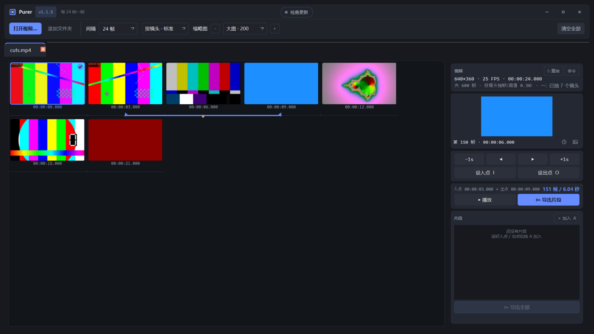
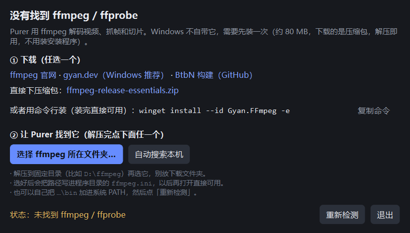

# Purer

**把视频铺成缩略图墙，翻素材、标入点出点、帧精确切片段。**


Purer 是一个 Windows 上的视频抽帧浏览 / 切片小工具（单文件 exe，免安装）。
拖进视频 → 每 N 帧取一张铺成图墙（**图墙本身就是时间轴**）→ 逐帧微调 →
设入点 / 出点 → **帧精确切片**（只重编码切点那 0.5–3 秒，中段保持原始码流）；
可以攒好几段，一次全部导出。

## 特点

- **图墙即时间轴**：缩略图下面那条线就是时间轴，刻度朝上；入点/出点画成一条蓝带，
  两端各有一个可以拖的小旗；当前帧是黄色小三角，精确到帧。
  小旗**横竖都能拖**：左右微调帧号，上下可以跳到别的行（自动吸附到离鼠标最近的那条时间轴，
  一次跳很远）；拖动过程中右侧预览和黄色三角都实时跟着**正在拖的那一帧**，
  不是停在原来的入点/光标上（拖的时候先出墙上的缩略图，停手 0.14 秒再补一张精确帧，所以不卡）。
- **帧精确切片**：调用 ffmpeg 只重编码「起点 → 下一个关键帧」这一小段再拼接，
  切出来的第一帧就是你点的那一帧，其余 99% 仍是无损原始码流。
  拼接后自动校验，不通过就**自动退回无损**并说明原因（不会给你一个坏文件）。
- **多段批量**：设好一段按 `A` 加入片段列表，一次导出 `Cut - 1_…`、`Cut - 2_…`，
  某一段失败不影响其它段。
  - **每个素材可以自己起名**：导出前的确认窗里每段一个输入框；留空就用系列名
    `Cut - 1_原视频名`、`Cut - 2_原视频名`…；重名会自动加 `(2)`、`(3)`，不会覆盖已有文件。
  - 片段列表里会显示起好的名字（悬停可看完整时间区间），再次导出会自动带出来。
- **设置窗（标题栏左上角「设置」）**：
  - **关于**：版本号、运行方式、发布仓库、ffmpeg / ffprobe 版本与来源、
    PySide6 / Qt / Python / 系统版本，以及程序目录、缓存目录、设置文件位置，
    可以一键复制诊断信息。
  - **缓存**：见下面「缓存」一节。
- **把图墙缓存留下来**：抽好的缩略图默认放在临时目录（同一视频同设置再开就秒开）；
  在 设置-缓存 里可以选择是否**保存**下来 —— 保存过的缓存跨重启、清理临时文件后
  依然能直接加载，不用重新抽帧。关闭程序时如果有「还没保存」的缓存，会先问一次
  怎么处理（三个策略 + 「不再提醒」）。
- **标签按缓存状态上色**：每个标签的**边框**就是这颗灯 —— `🔴 加载中`（红）→
  `🔵 未缓存`（蓝）→ `🟢 已缓存`（绿），底色还会混一点同色的淡色，
  一眼就能分出哪个标签已经存好了。选了自动保存策略时，图墙一渲染完就自己存，
  标签会自己变绿（不用再手动点）。
- **右键标签**：保存这一页的缓存 / 重新抽帧 / 关闭这一页 / 关闭其他 / 关闭全部。
- **标签栏横条**：上下各一条浅灰引导线（不再是单独一条白线），标签是圆角卡片。
- **从缓存导入**：主工具栏「添加文件夹」右边；列出现有缓存条目，双击或「加载视频」
  直接打开原视频（秒开，不重新抽帧）。原视频不在的条目会标黄。
- **记住上次的设置**：窗口大小/位置、抽帧间隔、抽帧方式、缩略图显示尺寸、侧栏宽度、
  「打开视频 / 添加文件夹」上次所在的目录都会记住；存在持久数据目录里，
  清理 `%TEMP%` 也不会丢。
- **低配不卡**：抽帧 / 导出共用一个队列（同一时刻只跑 1 个 ffmpeg，且只占一半 CPU 线程）；
  显示尺寸和抽取尺寸分离 —— 改缩放**不重抽**、不新增任务。
- **抽帧间隔默认「跟随视频帧率」**：每打开一个视频，间隔 = 它自己的帧率 → 真正**1 秒 1 张**
  （24fps 就是 24、25 就是 25、60 就是 60，23.976 的片子自动用 23.98）。
  下拉里有常用档：`1 / 2 / 3 / 4 / 6 / 8 / 12 / 24 / 25 / 30 / 50 / 60 / 120 帧`，
  外加 `23.98 / 29.97 / 59.94`（常见帧率下约 1 秒）；
  选任意数字就固定成那个值（会记住），想回到「跟帧率」重新选第一项即可。
  右侧会算出实际秒数：`每 23.98 帧 1 张 · ≈1.00 秒`。
- **按镜头抽帧**：抽取方式里选「按镜头 · 标准」，就改成**自动按镜头切分**——
  **一张缩略图 = 一个镜头**（不再是固定间隔）。
  - 两遍走：先用 ffmpeg 把整片缩成 32×18 灰度、算**每帧的灰度直方图**（一次解码，
    30 分钟片子总共才 ~26 MB），再按直方图的变化判切点；第二遍才按帧号清单抽图。
  - **为什么不用 ffmpeg 自带的 `scene` 分数**：它本质是"相邻两帧的像素差"，
    所以摇镜头/推拉/快速运动/闪白都会被当成切镜头（连贯镜头被切碎）；
    而叠化那种渐变又常常不够大（该切的地方没分开）。直方图对"画面整体分布"敏感、
    对"内容平移"不敏感，正合适。
  - 判据：硬切 = 局部极大 + 自适应阈值（整片均值 + kσ）；渐变 = 隔几帧的累计变化
    超阈值且首尾是两段不同画面（一次叠化只切一刀）；闪白/闪光（只跳一帧）会被排除。
  - 三档灵敏度：灵敏 / 标准 / 保守；不想太碎用「保守」。
  - 时间轴变成**按镜头轴**：格子宽窄不一，但格内仍按帧号线性插值，
    所以拖蓝旗、点帧、`←/→` **依然精确到帧**；一行只有一格也能拖。
  - 侧栏显示「按镜头（标准）」，状态栏「已抽 N 个镜头」，缓存按「镜头 + 档位」分开，秒开。

  
- **自带主题的标题栏**（不用 Windows 那个灰白栏）：整窗自绘，深色卡片跟界面同一套配色，
  右侧是最小化 / 最大化-还原 / 关闭；标题栏可以按住拖动、双击最大化、拖到屏幕顶边松手也最大化，
  窗口四边 6px 还能拉伸（拉伸交给系统，DPI 缩放和多屏都正常）。
- **标签页**：圆角卡片样式，当前标签更亮、带描边；关闭按钮是自绘的细 X，
  悬停有暗红底、按下更深（不再用系统默认的灰叉）。标签可拖动排序、可滚动。
- **检查更新（可自动安装）**：顶部卡片正中的药丸，启动后自动向 GitHub 查一次最新发布版本，
  点一下可以手动复查 —— **绿 = 已是最新**、**橙 = 有新版本**、**灰 = 没查成**（点一下重试）。
  有新版本时点橙色药丸就会**自动下载**（后台跑，界面能继续用）→ **校验 sha256**
  （对着 GitHub 给的资产校验值）→ 关闭程序、替换 exe（旧的留成 `Purer.exe.old`）、**自动重启到新版本**；
  任何一步失败都会回退到「打开发布页」，绝不会把程序搞坏。
  离线机器可以设 `PURER_NO_UPDATE=1` 完全不联网；只想手动装可以设 `PURER_NO_AUTO_UPDATE=1`。
- 不写工程文件；缩略图渲染在 `%TEMP%\Purer_cache`（7 天自动清理，同一视频同设置重开会秒开），
  保存下来的缓存默认在 **Purer 同目录的 `cache\`**（设置-缓存 里可改），设置文件/界面记忆在
  `%LOCALAPPDATA%\Purer\`（`settings.json` + `ui.ini`）。`PURER_CACHE_DIR` / `PURER_DATA_DIR`
  也可以改位置（便携用法）。

## 使用

1. 下载 `Purer.exe`，双击运行（免安装）。
2. 准备好 **ffmpeg / ffprobe**，任选一种方式让 Purer 找到它们
   （详见下面「ffmpeg 依赖」）。
3. 把视频（可多选）或**整个文件夹**拖进窗口 → 自动抽帧成图墙。
4. 点一帧 → 右侧预览该帧；按 `I` / `O` 设入点出点（或直接拖时间轴上的两个小旗）。
5. 点 **✂ 导出片段…** → 选保存位置。

每个视频一个标签页，标签可以拖动排序。顶部「间隔」决定抽帧密度，「缩略图 ±」只改显示大小。

## 快捷键

| 按键 | 作用 | 按键 | 作用 |
| --- | --- | --- | --- |
| `←` / `→` | 单帧前后 | `Home` / `End` | 首帧 / 末帧 |
| `Shift+←` / `Shift+→` | 前后 1 秒 | `PageUp` / `PageDown` | 前后一格（一个抽帧间隔） |
| `I` / `O` | 设入点 / 出点 | `A` | 把当前区间加入片段 |
| `空格` | 在预览里回放区间 | `Esc` | 停止回放 |
| `Ctrl+1~4` | 缩略图尺寸预设 | `Ctrl+滚轮` | 连续缩放缩略图 |
| `Ctrl+O` | 打开视频 | `Ctrl+W` | 关闭当前标签 |
| `Ctrl+,` | 打开设置 | | |

右键缩略图：设入点 / 出点、复制时间码、复制画面、查看大图、复制视频路径、导出选中区间。
双击缩略图 → 全屏大图（`Esc` 关闭）。

## 命令行

同一个 exe 也能当批处理工具（不加载界面）：

```
Purer.exe --help
Purer.exe --where                                  # ffmpeg / 缓存位置
Purer.exe --probe A.mp4 B.mkv                      # 媒体信息（JSON）
Purer.exe --extract A.mp4 -o 输出目录 --step 24 --long 320
Purer.exe --export A.mp4 12.5 24 -o 切片.mp4       # 时间支持 12.5 或 00:01:23.456
Purer.exe --selftest                               # 无窗口自检
```

> 命令行的时间是**左闭右开** `[起, 止)`（`12.5 24` = 11.5 秒）；
> 界面里的入点/出点是**帧号、右闭**（`#30 → #60` = 31 帧）。两者按各自习惯来。

## 缓存

抽帧的缩略图墙会先落在**临时目录**（`%TEMP%\Purer_cache`）：同一视频 + 同一组设置
（间隔 / 按镜头档位 / 抽取尺寸）再打开就秒开；7 天没动过的会被清掉。

想让它在重启电脑、清理临时文件之后还能直接加载，就在 **设置-缓存** 里选择保存策略
（**默认是「所有缓存都不自动保存」**，此时关闭程序会先问你一次）：

| 策略 | 含义 |
| --- | --- |
| 所有缓存都不自动保存 | 只用临时缓存（默认；关闭时仍然会提示一次） |
| 自动保存最近使用的，最多 N 个视频 | 关闭时按「最近使用」保留最多 N 个，超出按最久没用删除 |
| 自动保存用得多 / 导出过的素材 | 只有「使用时长 ≥ X 分钟」或「导出 ≥ Y 次」的才保存 |

只有选了上面两种**自动保存**策略、并且勾了「关闭前不再提醒」时，关闭才不会弹窗；
默认的「不自动保存」每次关闭都会提示（没有可自动执行的策略）。

同一页里还可以：

- 改 **缓存位置**（默认是 **Purer 同目录的 `cache\`**；程序目录不可写时自动退回
  `%LOCALAPPDATA%\Purer\cache`）：换位置时可以选「迁移」，把已有缓存一起搬过去；
  也可以直接切回以前用过的缓存目录。
- 调 **最大缓存体积**：默认取缓存所在磁盘总量的一小部分（0.5%，夹在 256 MB – 8 GB 之间），
  超过上限时自动删除最久没用的缓存；可以改成固定值，也可以「恢复默认」。
- 「立即保存本次已渲染的视频」和「清空已保存缓存」（只删缓存，不动视频文件）。
- **改完即存**：这一页的所有选项（策略 / 数量 / 时长 / 体积 / 提醒开关）一改就写进
  `settings.json`，底部会显示「✓ 已自动保存」；就算用 Esc 或标题栏的叉关掉窗口也不会丢。
  （之前只有点「关闭」才保存，顺手按 Esc 就白改了。）

关闭窗口时，如果**这次渲染完、但还没保存**的视频不止一个，会先弹一次提示：
逐个列出视频 / 张数 / 占用，并让你选上面的策略（也可以「仅这次不保存」）。
勾上 **不再显示这个提醒** 以后，只要选的是自动保存策略，就不再弹窗 —— 这个开关在
设置-缓存 里也能改。

平时也可以手动保存：**右键标签 → 保存这一页的缓存**（蓝色的时候才有这一项）。
选了自动保存策略的话，图墙渲染完就会自己存好、标签自己变绿，不用手动点。

已保存的缓存**连片段状态一起存**：片段列表、入点/出点、导出过的文件记录都写在条目里的
`segments.json`；下次从缓存打开同一个视频（同一组抽帧设置），片段列表和入点出点会原样恢复。

`设置-缓存 → 缓存条目` 是一个可展开的列表，逐条显示视频、抽帧设置、张数、体积和
保存时间；双击或「加载视频」直接用这条缓存打开原视频（不重新抽帧），
「删除缓存」只删缓存本身、不动视频文件。主工具栏的「从缓存导入」是同一个列表的弹窗版。

侧栏「片段」面板下方还有一个 **`▸ 已导出的片段（N）`** 小块：展开就是导出过的文件
（文件名 / 体积 / 精确还是无损），双击行或点「打开」用系统播放器打开，点「文件夹」
打开所在目录。这份记录也随缓存保存。

已保存的缓存是「硬链接优先」：和临时目录在同一块盘时不额外占空间，
临时目录被清掉也不影响它；跨盘时才退回复制。

## ffmpeg 依赖

需要 **ffmpeg / ffprobe**（Windows 不自带）。第一次打开如果没找到，程序会直接弹一个引导窗：



- **① 下载**：默认给的是**国内镜像**（npmmirror 同步的 `KarinJS/FFmpeg-Builds` 静态包，
  140 MB 直连几十秒下完，2026-11-11 实测 14 MB/s，不用梯子）：
  `…/ffmpeg-builds/v8.1.3/ffmpeg-8.1.3-win32-x64-gpl.tar.xz`。
  解压用 Win10/11 自带的 `tar -xJf 文件名`（或 7-Zip），解开后是 `bin\ffmpeg.exe` + `bin\ffprobe.exe`。
  官方源（`ffmpeg.org` / `gyan.dev` / `BtbN` 的 GitHub Releases）也留在窗口里，但国内实测只有几十 KB/s；
  GitHub 慢的话，官方地址前面加上 `https://ghfast.top/` 或 `https://gh-proxy.com/` 再打开即可加速。
  `winget install --id Gyan.FFmpeg -e` 也能用，但它拉的是 gyan.dev 的包，同样慢。
- **② 让程序找到它**：点 **「选择 ffmpeg 所在文件夹…」** 指到解压出来的 `bin`
  （或解压后的根目录），路径会写进程序目录的 `ffmpeg.ini`，以后再打开直接可用；
  或者点 **「自动搜索本机」**，让它自己扫盘找（限 3 秒，只认 **同时有 ffmpeg + ffprobe**
  的目录，不会被播放器自带的 ffmpeg 骗到）。
- 已经装好、刚改过 PATH？点 **「重新检测」**：程序会**重新读注册表里的 PATH**，
  不用重启也能立刻认出新装的 ffmpeg。直接重开程序当然也可以。

找 ffmpeg 的顺序（命中即用）：

1. 环境变量 `PURER_FFMPEG_DIR` 指向的目录；
2. 程序同目录的 `ffmpeg.ini`（`[ffmpeg]` 段里写 `dir=D:\你的\ffmpeg\bin`）；
3. 程序同目录、同目录 `bin\`、`ffmpeg\bin\`；
4. 系统 `PATH`；
5. WinGet / Chocolatey / Scoop 的常见安装位置、`C:\ffmpeg`、`C:\Program Files\ffmpeg`；
6. 兜底扫盘（仅当上面全都没命中，最多 3 秒，深度 4 层）。

最省事的两种：把 `ffmpeg.exe`、`ffprobe.exe` 丢到 `Purer.exe` 旁边，
或者用引导窗选一次目录。当前解析结果随时用 `Purer.exe --where` 查看。

### 不同 ffmpeg 构建的兼容性（v1.1.1 起）

各家的 ffmpeg 对 `select` 过滤链的解析规则并不一致：有的构建会把
`select='not(mod(n\,24))'` 里的反斜杠原样留在表达式里 → 抽帧一开就报
`Error while parsing expression` / `Error initializing filters`。

所以抽帧命令默认改成**单引号保护逗号**（`select='not(mod(n,24))'`，不带任何转义字符），
并在出错时自动按顺序换写法重试，只有「命令被这个 ffmpeg 拒绝」才重试（解码失败、磁盘满不重试）：

1. 单引号保护逗号（默认）；
2. 反斜杠转义逗号（早期写法）；
3. `fps=` 兜底（整条链没有逗号/转义，CFR 源取到的帧与 1 等价）；
4. 老 ffmpeg（< 5.1）不认 `-fps_mode` 时，以上三种再用 `-vsync 0` 各跑一遍。

界面上的报错会写明「已换 N 种命令写法」；`Purer.exe --selftest` 的
`extract ... variant=N` 也能看到这次实际用的是第几种（0 = 首选）。

### 回放（空格预览）曾经的两个坑（v1.1.8 修）

- **时间戳不单调会直接中止**：回放缓存是「`-ss` 跳过去 + `select` 抽稀 + 存 jpg」，
  跳到片尾那一段后时间戳不一定是递增的，jpeg 的 `image2` 封装遇到重复 dts 会报
  `Application provided invalid, non monotonically increasing dts to muxer` 并**当场退出**
  （实测一组 1080p HEVC 的 .mkv：只出 18~39 张、退出码 -1）→ 界面只剩一句
  「回放准备失败：回放缓存生成失败」。
  现在过滤链末尾加 `setpts=N`，把输出时间戳重编成 0,1,2…，同一段连跑 3 次都满张。
- **片尾差一张不算失败**：`.mkv` 大多没有 `nb_frames`，程序按「时长 × 帧率」估出来的
  末帧常常比真实末帧多 1 帧，于是「选区贴到片尾」永远差最后一张。
  以前只认「首尾两张都在」，就差这一张直接判失败。现在**允许片尾少几张，按实际张数播**
  （状态栏显示「可播 N 张（片尾不足）」），真正一张都抽不出来才算失败，
  并且会把 ffmpeg 最后几行报错写进提示里——不再是一句没有信息量的「回放缓存生成失败」。

## 从源码运行

```
pip install PySide6
python Purer.py
```

## 打包

```
pip install PySide6 pyinstaller
python build.py
```

`build.py` 会先用程序自己的绘制函数生成 `icon.ico`，再打包成单文件 `Purer.exe`
（`--collect-submodules vff`，确保包内模块都进去）。

## 测试

```
python -m unittest discover -s tests
python tests\gui_smoke.py
```

## 目录结构

```
Purer.py                入口薄壳（真正的实现在 vff/）
vff/
  __main__.py           命令行 / GUI 入口
  config.py             版本、常量、路径、ffmpeg.ini
  settings.py           应用设置（持久 JSON：缓存策略 / 上限 / 关闭提醒）
  cache.py              临时渲染缓存：缓存 key、目录、7 天回收
  cache_store.py        持久缓存库：保存 / 恢复 / 使用统计 / 体积收敛
  export_names.py       批量导出的素材命名（Cut - N_原名 / 去重）
  media.py              MediaInfo、ffprobe JSON 解析、文件发现
  ffmpeg.py             工具定位、参数构造、进度解析、执行
  jobs.py               任务 + 串行队列
  smartcut.py           智能切割：方案判定 / 拼接后校验 / 自动回退
  selftest.py           自检
  ui/                   界面（主题、主窗口、标签栏上色、单视频页、侧栏、图墙时间轴、
                        控件、对话框、设置窗、缓存条目表、从缓存导入窗）
tests/                  单测 + 界面冒烟
```

## 许可证

[MIT](LICENSE) © 2026 TMHC
