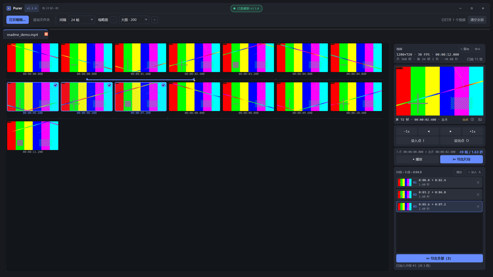

# Purer

**把视频铺成缩略图墙，翻素材、标入点出点、帧精确切片段。**

Windows 上的视频抽帧浏览 / 切片小工具：单文件 exe，免安装，不写工程文件。
拖进视频 → 一秒一张（或一个镜头一张）铺成图墙 → 逐帧微调 → 设入点出点 →
帧精确切片；可以攒好几段，一次全部导出。

## 特点

| 功能 | 说明 |
| --- | --- |
| **图墙即时间轴** | 缩略图下面那条线就是时间轴。入点/出点是一条蓝带，两端小旗可拖（左右调帧、上下换行）；当前帧是黄色小三角，精确到帧 |
| **PR 式标记** | `M` 在播放头加绿色标记（和入点/出点无关），`Shift+M` 下一个、`Ctrl+Shift+M` 上一个；墙上时间轴和底部总进度条都显示 |
| **底部总进度条** | 整段视频缩成一条：点/拖移动光标，拖两端小旗改入点/出点，片段标记一点即跳；和墙上时间轴共用同一份状态 |
| **帧精确切片** | 只重编码「起点 → 下一个关键帧」这一小段再拼接，第一帧就是你点的那帧，其余仍是无损原始码流；拼接后自动校验，不通过自动退回无损 |
| **多段批量** | 按 `A` 把当前区间加入片段，一次导出 `Cut - 1_…`、`Cut - 2_…`；每段可改名，重名自动加 `(2)` |
| **抽帧** | 默认「跟随视频帧率」（1 秒 1 张，23.98 / 25 / 30 / 60… 自动适配）；也可「按镜头」——一张图 = 一个镜头 |
| **缓存秒开** | 同一视频同设置再开秒开，还能保存下来跨重启；标签边框按状态变色：🔴 加载中 / 🔵 未缓存 / 🟢 已缓存 |
| **不丢活儿** | 标签、当前帧、入出点、标记、片段、导出记录每 30 秒存一次；关掉再开、更新重启、断电重开都能接上 |
| **安静地更新** | 发现新版本弹窗问一次（立即更新 / 一周后提醒 / 忽略此版本 / 不再提醒）；只改代码的小版本下载 ~180 KB，**装完不用重启** |
| **界面** | 自绘深色标题栏 + 圆角标签页；抽帧和导出共用一个队列，低配也不卡 |

## 使用

1. 下载 `Purer.exe`，双击运行（免安装）。
2. 把视频（可多选）或整个文件夹拖进窗口 → 自动抽帧成图墙。
3. 点一帧，按 `I` / `O` 设入点 / 出点（或直接拖时间轴 / 底部总进度条上的小旗）。
4. 点 **✂ 导出片段…** 选保存位置；多段就先按 `A` 加入片段列表，最后一次性导出。

> 找不到 ffmpeg 时会自动弹引导窗（国内镜像，几十秒下完）。
> 操作细节、命令行、缓存策略、按镜头判据、ffmpeg 查找顺序 → 见 `MANUAL.ignore`。

## 快捷键

| 按键 | 作用 | 按键 | 作用 |
| --- | --- | --- | --- |
| `←` / `→` | 单帧前后 | `Home` / `End` | 首帧 / 末帧 |
| `Shift+←` / `Shift+→` | 前后 1 秒 | `PageUp` / `PageDown` | 前后一格 |
| `I` / `O` | 设入点 / 出点 | `A` | 把当前区间加入片段 |
| `M` | 添加标记 | `Shift+M` | 下一个标记 |
| `Ctrl+Shift+M` | 上一个标记 | `=` / `-` | 缩放缩略图 |
| `空格` | 回放区间 | `Esc` | 停止回放 |
| `Alt+1~4` | 缩略图尺寸 | `Alt+滚轮` | 连续缩放 |
| `Ctrl+O` | 打开视频 | `Ctrl+W` | 关闭当前标签 |
| `Ctrl+,` | 打开设置 | | |

右键缩略图：设入点 / 出点、删除标记、复制时间码、复制画面、查看大图、复制视频路径、导出选中区间。
双击缩略图 → 全屏大图（`Esc` 关闭）。

## 许可证

[MIT](LICENSE) © 2026 TMHC
